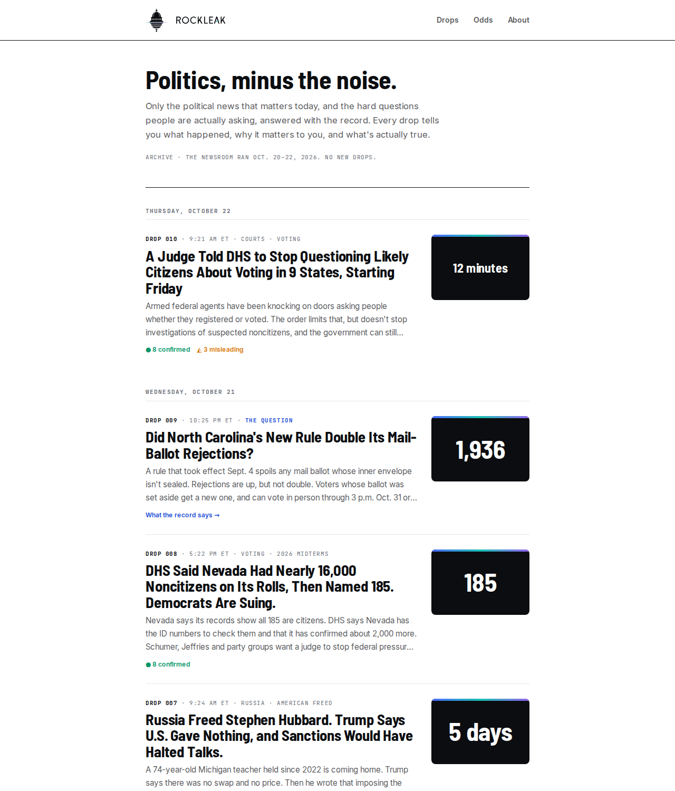
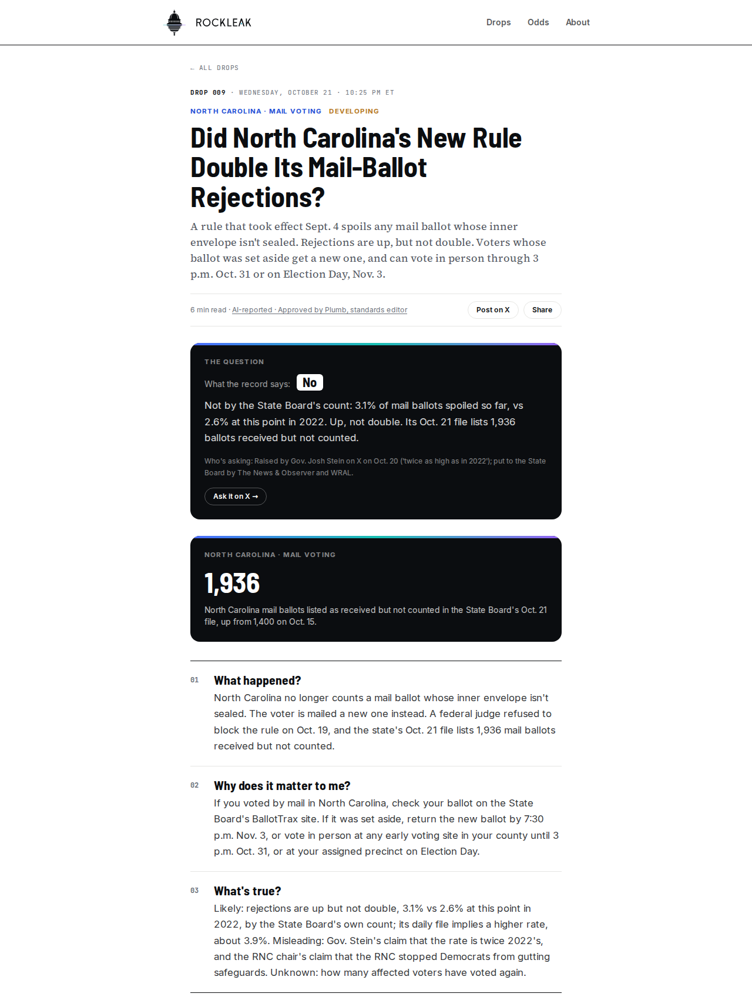
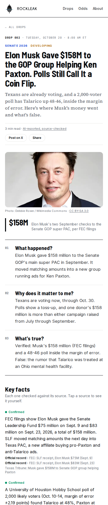
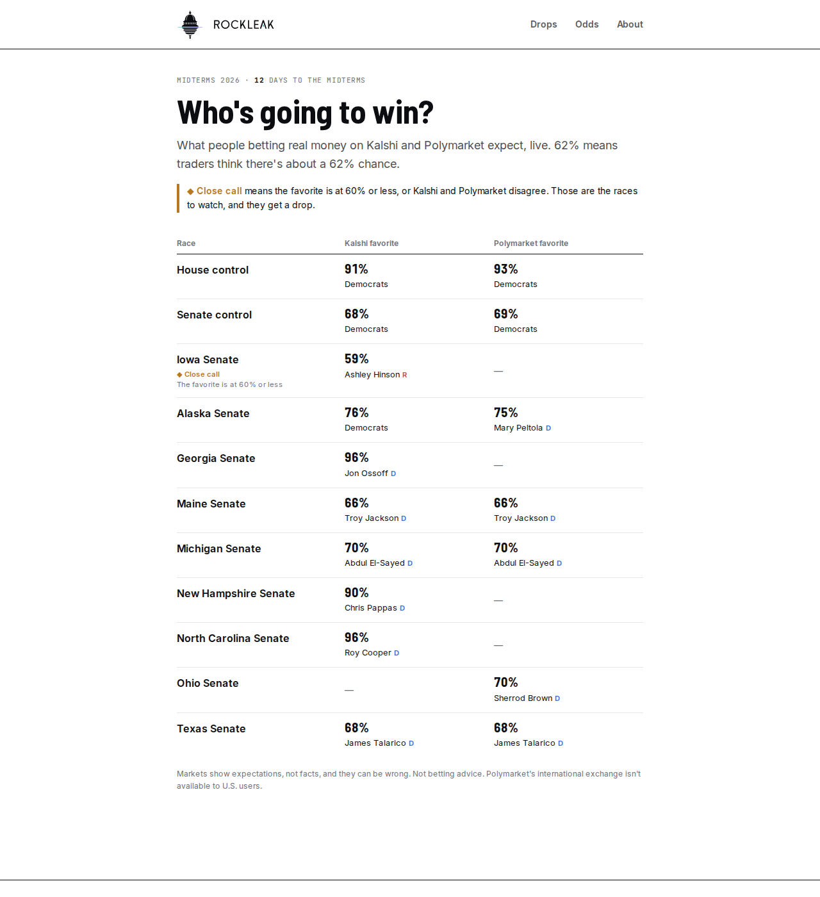
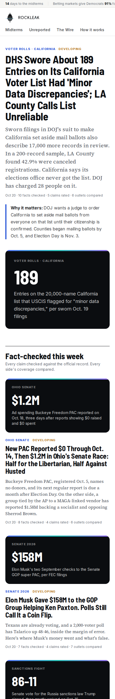
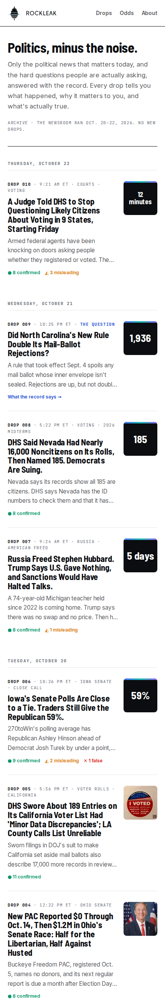

# Case study: RockLeak, an AI newsroom for American politics

**Live site:** [rockleak-roan.vercel.app](https://rockleak-roan.vercel.app) · **Built:** Oct 20–22, 2026 · **Status:** finished, archived

RockLeak was an experiment in one question: can a team of AI agents run a small, trustworthy political newsroom,
one that finds the story, checks it against the primary record, argues about it from every side, and only
publishes what a neutral editor signs off on?

## The problem

- People don't trust any single outlet. On the same event, Fox, CNN and Politico often run three different stories.
- Tools like Ground News and AllSides show you *who* covered a story, but not *what is actually true*, with receipts.
- Prediction markets (Kalshi, Polymarket) became a mainstream signal for the 2026 midterms, but nobody put them
  next to the facts.

## What I built

A news site that publishes **"drops"**: short, checked political stories, released three times a day
(9 AM, 5 PM and 10 PM Eastern) in the run-up to the Nov. 3, 2026 midterms.

Every drop answers three questions, in this order:

1. **What happened?**
2. **Why does it matter to me?**
3. **What's true?** Every key fact carries a verdict (confirmed, likely, misleading, false) and a link to its source.

The short version and key facts come first. The full story, the claims going around, how each side covered it,
and what's still unknown sit underneath for anyone who wants to dig deeper.

| A "question" drop | A drop on a phone |
|---|---|
|  |  |

### Features

- **The Question.** Some drops lead with the hard question people are already asking ("Did North Carolina's new
  rule double its mail-ballot rejections?") and answer it right underneath from the record: *Yes*, *No*, *Partly*
  or *Nobody knows yet*, plus who is asking it. Curiosity without accusation.
- **Live betting odds.** Kalshi and Polymarket favorites for every major race, side by side. A race is flagged as a
  **close call** when the favorite is at 60% or less, or when the two markets disagree, and close calls get a drop
  of their own.
- **Fair photos only.** Story photos come from Wikimedia Commons, and the publishing tool accepts only free licenses
  (public domain, CC0, CC BY, CC BY-SA) with credit shown.
- **Built to be shared.** Generated share images for every story, structured data for Google (NewsArticle and FAQ
  markup), a sitemap, and one-tap "Post on X" buttons.

## How the AI newsroom worked

Each scheduled run was a fresh Claude Code session following a written playbook
([`newsroom/PLAYBOOK.md`](../newsroom/PLAYBOOK.md)):

1. **Brief.** A script pulled the wire (headlines from 21 outlets, left to right), FEC filings, and the live odds.
2. **Pick.** The run chose the one story a regular reader most needed that day.
3. **Report.** It researched the story against primary sources: court orders, FEC filings, state election data.
4. **Debate.** Four agents with different viewpoints argued from the same facts: Grant (right), Rosa (left),
   Mercer (center) and Vex (outsider). Each one had to concede something.
5. **Write.** Quill, the editor agent, wrote the draft.
6. **Approve.** **Plumb**, a separate neutral standards editor, reopened the sources, ran a "swap the parties"
   symmetry test, and approved, sent back, or killed the story using a written rulebook
   ([`newsroom/STANDARDS.md`](../newsroom/STANDARDS.md)).
7. **Publish.** The publishing tool checked the story against a strict schema and **refused anything without
   Plumb's sign-off**, then deployed it and confirmed it was live.

It ran on a Claude subscription through scheduled tasks on an always-on home PC, so it needed no paid API keys.

## Results

- **10 drops in 3 days**, covering court rulings, voter-roll fights, super PAC money, and close Senate races.
- **82 key facts** published, 74 rated *confirmed* and 8 *likely*, backed by **137 unique source links**.
- **Plumb sent every story back at least once.** Every one of the 7 newsroom drafts that were published failed
  its first review, for things like a missing poll in an average, a missing rebuttal from the other side, or
  rating one party's claim more harshly than the other's. All were fixed and approved in round two.
- Several drops covered things the newsroom found no other outlet reporting, by reading the primary filings directly,
  such as a new PAC's $1.2M in Ohio's Senate race and a sworn DHS footnote in its suit against California.

## What changed along the way

- **Version 1 was too much.** The first design was a full news site: a wire of every headline, an "unreported"
  desk, an odds board, debate transcripts and agreement scores on the front page. It was impressive, but
  overwhelming for someone who isn't a news junkie.
- **Version 2 took its cue from WikiLeaks.** Rare releases made each one feel important. The site became a quiet
  stack of drops, with the essential story of the day only, the three-question format, and a short About page
  written for a Gen Z reader.

| Before | After |
|---|---|
|  |  |

## What I learned

- **Less is more for news.** The hardest product work was cutting: deciding what a reader needs to feel "set for
  the day" and hiding everything else behind a tap.
- **AI agents need a gatekeeper.** The writing agents were confident and often a little one-sided. A separate,
  strict reviewer with a written rulebook caught real fairness problems on every story.
- **Rules beat good intentions.** The most reliable safeguards were enforced in code: the publish tool refusing
  unapproved stories, headline length limits, photo license checks, and "a question headline must carry its
  answer".
- **Automation is a commitment.** Three runs a day produced real reporting, but keeping a newsroom fresh is a
  daily job. I ended the scheduled runs on Oct. 22, 2026 and kept the site as an archive.

## Stack

Next.js 16 (App Router, Cache Components) on Vercel · TypeScript · Tailwind CSS v4 · Zod schemas ·
Claude (Claude Code for the scheduled newsroom; the Anthropic SDK for an optional API-key pipeline) ·
Kalshi and Polymarket public APIs · FEC and Congress.gov APIs · Wikimedia Commons.

More detail: [ARCHITECTURE.md](../ARCHITECTURE.md) · [VISION.md](../VISION.md)
